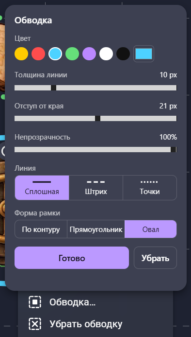

# Prop Outlines for Owlbear Rodeo

An extension for [Owlbear Rodeo](https://www.owlbear.rodeo/) that adds an outline around objects on the **Props** layer—following the image's outer contour, a custom outline path, or an oval shape.


## Features

- **Contour outlining:** The frame follows the shape of a PNG image (including its transparency) rather than simply enclosing it in a rectangle.
- **Rectangular or oval shapes:** Available for when a simple frame is needed.
- **Customizable settings:** Choose colors (from a preset palette or your own), line thickness, offset from the edge, opacity, and line style (solid, dashed, or dotted).
- **Frame follows the object:** The frame moves, rotates, resizes, hides, duplicates, and deletes in sync with the object it surrounds.
- **Prevents accidental selection:** Clicks pass through the frame, allowing you to interact directly with the object underneath.
- **Multiple objects can be outlined at once.**
- **Persistent settings:** New frames are automatically created using the parameters from your most recent selection.

## Installation

1. In Owlbear Rodeo, go to **Profile → Extensions → Add Custom Extension**.
2. Paste the link:
   ```
   https://stastriada1995-rgb.github.io/prop-outline/manifest.json
   ```
3. Click **Add**.
4. In the room, open the puzzle-piece icon (Extensions) and enable **"Prop Outline"**.

## How to use

1. Select one or more items on the Props layer.
2. Right-click → **"Outline…"**.
3. Choose the shape, color, and thickness, then click **"Apply"**.



To modify the stroke, open **"Stroke…"** again; the changes will be visible immediately. You can remove the stroke by clicking the **"Remove"** button in the window or by selecting the **"Remove stroke"** menu option.

## Good to know

- **Thickness and offset** are measured in scene pixels. On the standard grid, one cell equals 150 px.
- A **negative offset** draws the border inside the object.
- The **border size** automatically adjusts when an object is scaled. Moving or rotating an object affects the border accordingly.
- **If the outline cannot be generated** (for example, if the image is sourced from a website that prohibits such access), a rectangular border is drawn instead, and a warning appears in the window.
- **Fine details:** The outline is generated based on a downscaled version of the image and is slightly smoothed; consequently, very fine details—only a few pixels wide—are encompassed by the general outline.

## Version

1.2.1
