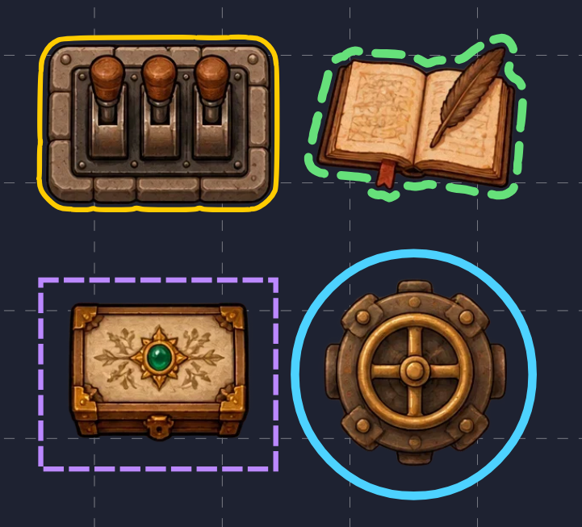

# Обводка реквизита для Owlbear Rodeo

Расширение для [Owlbear Rodeo](https://www.owlbear.rodeo/), которое добавляет рамку-обводку вокруг предметов на слое **Props**: по видимому контуру картинки, прямоугольником или овалом.



## Возможности

- **Обводка по контуру.** Рамка повторяет форму PNG с прозрачностью, а не просто обводит его квадратом.
- **Прямоугольник или овал**, если нужна простая рамка.
- **Настройки:** цвет (готовая палитра или свой), толщина линии, отступ от края, непрозрачность, стиль линии (сплошная, штрих, точки).
- **Рамка следует за предметом:** двигается, поворачивается, меняет размер, скрывается, копируется и удаляется вместе с ним.
- **Рамку нельзя случайно выделить:** клики проходят сквозь неё на сам предмет.
- **Можно обвести сразу несколько предметов.**
- **Настройки запоминаются:** следующая обводка создаётся с последними выбранными параметрами.

## Установка

1. В Owlbear Rodeo откройте **Профиль → Extensions → Add Custom Extension**.
2. Вставьте ссылку:
   ```
   https://stastriada1995-rgb.github.io/prop-outline/manifest.json
   ```
3. Нажмите **Add**.
4. В комнате откройте значок пазла (Extensions) и включите **«Обводка реквизита»**.

## Как пользоваться

1. Выделите один или несколько предметов на слое Props.
2. Правый клик → **«Обводка…»**.
3. Выберите форму, цвет и толщину и нажмите **«Применить»**.


Чтобы изменить обводку, снова откройте **«Обводка…»**: изменения видны сразу. Убрать обводку можно кнопкой **«Убрать»** в окне или пунктом меню **«Убрать обводку»**.

## Полезно знать

- **Толщина и отступ** указаны в пикселях сцены. При стандартной сетке клетка равна 150 px.
- **Отрицательный отступ** рисует рамку внутри предмета.
- **Размер рамки** после масштабирования предмета подгоняет клиент мастера (GM). Перемещение и поворот работают у всех сразу.
- **Если контур не удалось прочитать** (например, картинка взята с чужого сайта, который это запрещает), рисуется прямоугольная рамка, а в окне появляется предупреждение.
- **Мелкие детали:** контур строится по уменьшенной копии картинки и слегка сглаживается, поэтому тонкие детали толщиной в пару пикселей обходятся общим контуром.

## Версия

1.2.1
